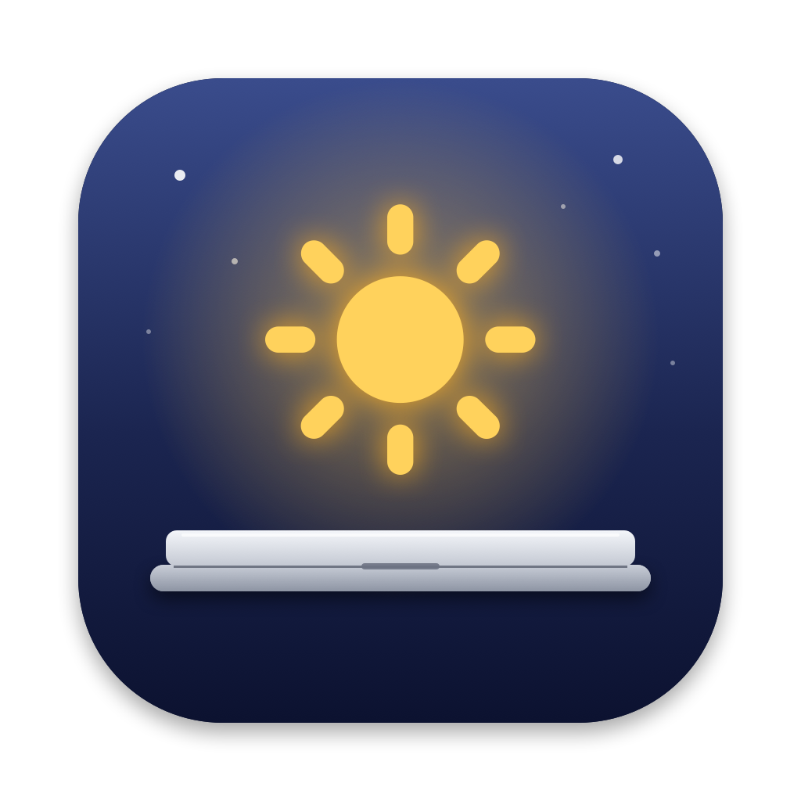

<p align="center">
  
</p>

<h1 align="center">Clampless</h1>

<p align="center">
  외부 모니터 없이도 맥북 덮개를 닫은 채 깨어 있게 해 주는 메뉴바 앱<br>
  <sub>Clamshell, minus the display — Intel / Apple Silicon Universal · macOS 11+</sub>
</p>

---

macOS의 클램셸 모드는 전원·외부 모니터·외장 입력장치가 모두 연결돼 있어야 동작합니다.
Clampless는 모니터 없이 덮개를 닫아 두고 **SSH·화면 공유로 맥미니처럼 원격 사용**하다가,
필요할 때 덮개를 열어 평소처럼 쓰는 사용 방식을 위해 만들었습니다.

내부적으로는 `pmset -a disablesleep 1|0` 을 메뉴바 아이콘 클릭 한 번으로 토글합니다.

## 기능

| 동작 | 결과 |
|---|---|
| 아이콘 좌클릭 | 켜기/끄기 토글 (☀︎ 켜짐 / ☾zz 꺼짐) |
| 우클릭 또는 control+클릭 | 메뉴 |

메뉴 항목

- **배터리 사용 시 자동으로 끄기** (기본 켜짐) — 가방 속 과열 방지
  - 켜진 상태에서 전원 어댑터를 뽑으면 **즉시** 끔 (들고 나갈 때)
  - 배터리 상태에서 켜면 **5분 유예** — 그 안에 전원을 연결하면 계속 켜짐, 아니면 끔
    (배터리로 켜고 → 덮개 닫고 → 거치대에서 전원 연결하는 흐름)
- **종료 시 끄기** (기본 켜짐) — 앱 종료 시 원래 잠자기 동작으로 복구
- **로그인 시 실행** (macOS 13+)
- **권한 설정 제거…**

터미널에서 직접 `pmset` 을 바꿔도 10초 이내에 아이콘에 반영됩니다.

## 설치

### 릴리즈에서 받기

[Releases](https://github.com/devhun/clampless/releases/latest) 에서 `Clampless-vX.Y.Z-macos-universal.zip` 을 받아 압축을 풀고 `/Applications` 로 옮깁니다.

Apple 공증(notarization)을 받지 않은 ad-hoc 서명 앱이라 처음 실행 시 Gatekeeper가 막습니다.
시스템 설정 → 개인정보 보호 및 보안 → **"그래도 열기"** 를 누르거나, 터미널에서 격리 속성을 제거하세요.

```bash
xattr -dr com.apple.quarantine /Applications/Clampless.app
```

### 직접 빌드

Xcode 없이 Command Line Tools(`swiftc`, `lipo`, `codesign`)만 있으면 빌드됩니다.

```bash
./build.sh                                  # → build/Clampless.app (x86_64 + arm64)
cp -R build/Clampless.app /Applications/
open /Applications/Clampless.app
```

## 자동 업데이트

시작 15초 후와 이후 1시간마다 새 릴리즈를 확인하고, 있으면 받아서 교체 후 다시 실행합니다.
(메뉴: 버전 표시 · 업데이트 확인… · 자동 업데이트 켜기/끄기)

- `api.github.com` 대신 `https://github.com/devhun/clampless/releases/latest` 의 302 리다이렉트에서
  최신 태그를 읽으므로 GitHub API 호출 한도(비인증 시간당 60회)에 걸리지 않습니다.
- zip은 릴리즈의 `checksums.txt`(SHA-256)로 검증한 뒤 교체합니다.
- 업데이트로 재시작할 때는 잠자기 방지 상태를 유지합니다 (원격 접속이 끊기지 않도록).
- 로컬 빌드(`0.0.0-dev`)는 자동 업데이트하지 않습니다.

## 권한

`disablesleep` 은 root 권한이 필요합니다. 처음 토글할 때 관리자 비밀번호를 **한 번** 묻고,
아래 sudoers 규칙을 설치해 이후에는 비밀번호 없이 동작합니다.

```
# /etc/sudoers.d/clampless
<사용자> ALL=(root) NOPASSWD: /usr/bin/pmset -a disablesleep 0, /usr/bin/pmset -a disablesleep 1
```

허용 범위는 위 두 명령뿐이며, 메뉴의 "권한 설정 제거…" 로 삭제할 수 있습니다.

## 원격 사용 팁

- 시스템 설정 → 일반 → 공유 → **원격 로그인**(SSH), **화면 공유** 켜기
- 전원 어댑터를 연결하고 통풍되는 곳에 두기 (덮개를 닫으면 발열이 빠지기 어려움)

## 수동 확인 / 복구

```bash
pmset -g | grep SleepDisabled     # 켜져 있으면 "SleepDisabled 1"
sudo pmset -a disablesleep 0       # 수동 해제
```

## 구조

```
Sources/main.swift          메뉴바 앱 전체 (AppKit, 단일 파일)
Resources/Info.plist        LSUIElement 앱 번들 설정 (Dock 아이콘 없음)
Resources/AppIcon.icns      앱 아이콘
Scripts/make_icon.swift     아이콘을 코드로 그리는 스크립트
Scripts/make_icon.sh        PNG → .icns 변환
build.sh                    Universal 빌드 + 번들 + ad-hoc 서명
.github/workflows/release.yml  태그 푸시 시 빌드 → GitHub Release 업로드
```

## 릴리즈

`v*` 태그를 푸시하면 GitHub Actions(macOS 러너)가 빌드해 Release에 zip과 `checksums.txt` 를 올립니다.
앱 버전은 태그에서 가져옵니다 (`v1.2.0` → `1.2.0`).

```bash
git tag v1.2.0
git push origin v1.2.0
```
